<div align="center">



<br><br>

[](CHANGELOG.md)
[](https://code.claude.com/docs/en/plugins/mods/overview)
[](#install)
[](hooks/register.tsx)
[](https://github.com/kuehn-lars/cc-graph/actions/workflows/ci.yml)
[](#privacy)
[](LICENSE)

<samp>[install](#install) · [the pane](#the-pane) · [privacy](#privacy) · [roadmap](#roadmap) · [changelog](CHANGELOG.md)</samp>

</div>

<br>

<samp>After a long turn, nobody can say without scrolling back what Claude actually has in context. **cc-graph** is a [Claude Code mod](https://code.claude.com/docs/en/plugins/mods/overview) that draws it in a live pane beside the conversation: every file Claude read, searched or changed, how those files import each other, and what compaction took away.</samp>

<a name="install"></a>
<br>


```text
/plugin install cc-graph --marketplace kuehn-lars/cc-graph
```

<samp>Then type **/graph**. Needs Claude Code v2.1.287 or later, in the terminal.</samp>

<a name="the-pane"></a>
<br>




| <samp>control</samp> | <samp>what it does</samp> |
| :-- | :-- |
| <kbd>g</kbd> | <samp>graph view</samp> |
| <kbd>l</kbd> | <samp>list view</samp> |
| <kbd>1</kbd> … <kbd>9</kbd> | <samp>pick a row in the list</samp> |
| `maxNodes` = `60` | <samp>most files in the graph, in /config</samp> |
| `importEdges` = `on` | <samp>show file imports, in /config</samp> |
| `blindSpots` = `on` | <samp>look for blind spots with git, in /config</samp> |
| `captureThinking` = `on` | <samp>keep thinking excerpts, in /config</samp> |

<samp>Files a shell command created, deleted or changed show too, named with the command that did it, and so do files Claude read with `cat`, `head` or `sed -n`. Files that import a change but were never opened are flagged as blind spots while the turn is still running.</samp>

<samp>The list also shows Claude's newest thinking: a short excerpt per step, with its turn and the files that step read or changed. Claude Code passes thinking text to mods only when `"showThinkingSummaries": true` is in your settings (or with `--thinking-display summarized`). This holds for every 5.5 model: Opus, Sonnet and Haiku. Without it, the footer says thinking is hidden.</samp>

<a name="privacy"></a>
<br>


<samp>cc-graph only watches. Its hooks pass every tool result on untouched and record what happened in session memory.</samp>

- <samp>**Nothing leaves your machine.** No network requests, no model calls, no files written.</samp>
- <samp>**Paths, sizes and counts**, never file contents. The one exception is Claude's newest 20 thinking excerpts, at most 400 characters each, and only while `captureThinking` is on. All of it is gone when the conversation ends or on /clear.</samp>
- <samp>**The only process it starts is read-only git**, by argument list, never through a shell.</samp>
- <samp>**Check it yourself:** claude plugin validate lists every event cc-graph hooks and every API method it calls. CI fails if the code goes beyond the [allowed list](specs/03-nfr/spec.md#privacy-and-security).</samp>

<a name="roadmap"></a>
<br>




<samp>Features, exit gates and spikes per milestone are in [ROADMAP.md](ROADMAP.md).</samp>

<details>
<summary><samp><b>develop</b></samp></summary>

<br>

<samp>The project is spec-driven: [specs/](specs/README.md) is the source of truth, and each feature goes from spec to failing tests to code. Instructions for Claude Code working on this repository are in [CLAUDE.md](CLAUDE.md).</samp>

```sh
claude --plugin-dir .          # run with the mod loaded (use a copy of fixtures/sample-app)
npx tsc -p . && claude plugin test && node scripts/check-calls.mjs
node scripts/trace.mjs --check # every approved acceptance criterion has a test
```

</details>

<br>

<div align="center">
<samp><a href="LICENSE">MIT</a> © 2026 Lars Kühn · built with and for <a href="https://claude.com/claude-code">Claude Code</a></samp>
</div>
